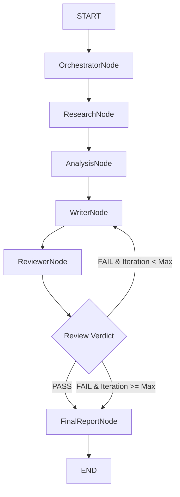

# LangGraph Orchestration Skill

## When to Use
Use when defining multi-agent workflows, state graphs, agent nodes, conditional edge routing, review loops, persistence checkpointers, and human-in-the-loop approval gates.

## Graph Topology


## Step-by-Step Procedure

### 1. Typed State Definition
- Define the shared workflow state in `app/workflows/state.py` using `TypedDict` or Pydantic:
  ```python
  class ResearchWorkflowState(TypedDict):
      session_id: str
      execution_id: str
      user_id: str
      query: str
      sub_queries: List[str]
      sources: List[Dict[str, Any]]
      evidence: List[Dict[str, Any]]
      analysis: Optional[Dict[str, Any]]
      draft_report: Optional[str]
      review_feedback: Optional[Dict[str, Any]]
      iteration_count: int
      status: str
      errors: List[str]
      approval_required: bool
      final_report_id: Optional[str]
  ```

### 2. Node Function Design
- Keep nodes modular and pure: each node takes `state` as input and returns a dictionary of updated keys.
- Nodes must wrap agent business logic and catch domain exceptions gracefully.
- Track per-node duration, token usage, and status in telemetry.

### 3. Conditional Routing & Loop Bounds
- Implement router in `app/workflows/router.py`:
  ```python
  def route_after_review(state: ResearchWorkflowState) -> str:
      feedback = state.get("review_feedback") or {}
      passed = feedback.get("passed", False)
      iterations = state.get("iteration_count", 0)
      max_iterations = 3

      if passed:
          return "final_report"
      if iterations >= max_iterations:
          # Bound exceeded: mark for human attention
          state["status"] = "NEEDS_HUMAN_REVIEW"
          return "final_report"
      return "writer"
  ```

### 4. PostgreSQL State Checkpointing & Resumption
- Configure `AsyncPostgresSaver` backed by the application's PostgreSQL instance.
- Provide a persistent `thread_id` (using `session_id` or `execution_id`) for every execution.
- Ensure the workflow can survive backend crashes and resume execution from the last committed checkpoint.

### 5. Human-in-the-Loop Interrupts
- Use LangGraph `interrupt()` before critical non-reversible actions:
  - Approving discovered search sources.
  - Approving final report publishing.
- Store approval state in database; resume execution via graph resume API with updated user inputs.

## Verification Checklist
- [ ] Workflow state is strictly typed.
- [ ] Review loop has an unbreakable maximum iteration limit (default 3).
- [ ] Postgres checkpointer configured and tested across worker restarts.
- [ ] Interrupt and resume mechanisms properly persist pending state.
- [ ] Node execution order is strictly sequential to respect local hardware limits.
- [ ] Unit tests verify each node in isolation; integration tests verify the full graph cycle.

## Common Mistakes to Avoid
- **Unbounded Revision Cycles**: Omitting iteration counters leading to infinite writer-reviewer ping-pong loops.
- **In-Memory Checkpointers in Production**: Using `MemorySaver` in production paths, which loses state on server reload.
- **Mutating State Directly**: Mutating nested state objects in-place instead of returning new state dict updates.
- **Unmanaged Parallel Branches**: Fan-out topologies running parallel LLM nodes simultaneously, which violates the single-GPU execution rule.
