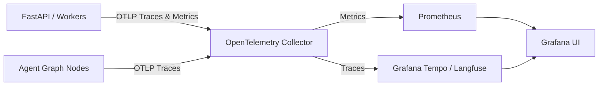

# Observability & OpenTelemetry Engineering Skill

## When to Use
Use when configuring distributed tracing, application metrics, Prometheus scrapers, Grafana dashboards, LangGraph execution tracing, or debugging performance bottlenecks in ResearchPilot AI.

## Observability Architecture


## Step-by-Step Procedure

### 1. Execution ID Correlation
- Every research session must generate a unique `execution_id` (UUIDv4) upon creation.
- Propagate `execution_id` across:
  1. API request headers (`X-Execution-ID`).
  2. Structured JSON log records (`{"execution_id": "...", "node": "writer", ...}`).
  3. OpenTelemetry trace span attributes (`span.set_attribute("research.execution_id", execution_id)`).
  4. LangGraph state dictionary.

### 2. OpenTelemetry Tracing Setup
- In `app/integrations/telemetry/otel.py`, initialize the OpenTelemetry TracerProvider and MeterProvider.
- Instrument FastAPI with `FastAPIInstrumentor`.
- Instrument LangGraph nodes using custom span contexts:
  ```python
  from opentelemetry import trace

  tracer = trace.get_tracer("researchpilot.agent")

  def timed_agent_node(node_name: str):
      def decorator(func):
          async def wrapper(state: Dict[str, Any], *args, **kwargs):
              with tracer.start_as_current_span(f"agent.{node_name}") as span:
                  span.set_attribute("agent.name", node_name)
                  span.set_attribute("execution_id", state.get("execution_id", ""))
                  return await func(state, *args, **kwargs)
          return wrapper
      return decorator
  ```

### 3. Prometheus Metrics Definition
- Define key Prometheus counters and histograms:
  - `research_workflow_duration_seconds`: Histogram measuring end-to-end research runtime.
  - `agent_node_duration_seconds`: Histogram labeled by `node_name` (`research`, `analysis`, `writer`, `reviewer`).
  - `llm_token_count_total`: Counter labeled by `model_name`, `provider`, and `type` (`prompt` vs `completion`).
  - `reviewer_verdict_total`: Counter labeled by `verdict` (`pass` vs `fail`).
  - `active_research_jobs`: Gauge tracking currently executing workflows.

### 4. Grafana Dashboards as Code (`infrastructure/observability/`)
- Store dashboard definitions as declarative JSON files:
  - `workflow_overview.json`: Latency percentiles (p50, p95, p99), active queues, success vs error rates.
  - `llm_performance.json`: Token consumption, tokens/sec throughput, Ollama latency breakdown, GPU VRAM utilization.
  - `agent_reliability.json`: Reviewer rejection counts, retry frequency, tool failure rate.

## Verification Checklist
- [ ] Every agent execution has a unified `execution_id` present in logs, traces, and metrics.
- [ ] OpenTelemetry traces capture all LangGraph node transitions.
- [ ] Prometheus metrics endpoint (`/api/v1/metrics`) exposes operational telemetry.
- [ ] Grafana dashboard JSON files provision cleanly in `docker-compose.observability.yml`.
- [ ] No secrets or raw PII logged in trace attributes.

## Common Mistakes to Avoid
- **Logging Sensitive Content**: Injecting full research documents or private user prompts into OpenTelemetry span tags, causing privacy leaks and high telemetry storage overhead.
- **Uncorrelated Traces**: Starting spans without setting parent span contexts, resulting in disconnected trace graphs.
- **High-Cardinality Metric Labels**: Using dynamic IDs (e.g. `user_id` or `session_id`) as Prometheus metric labels, causing Prometheus memory exhaustion.
- **Synchronous Telemetry Export**: Blocking the FastAPI request cycle on slow telemetry collector endpoints. Use asynchronous batch span processors.
