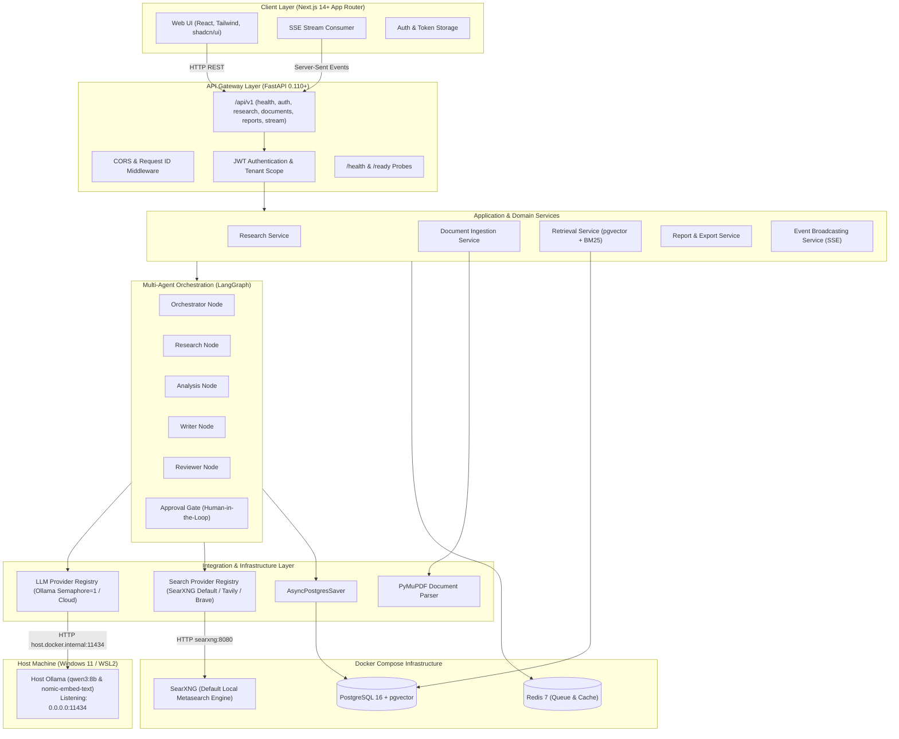

# ResearchPilot AI: Architecture Specification

## 1. Executive Summary & System Mission
ResearchPilot AI is a production-grade, local-first multi-agent autonomous research platform. Given a complex user inquiry, it orchestrates specialized autonomous agents (Orchestrator, Research, Analysis, Writer, Reviewer) through a directed cyclical graph to search the web and parse uploaded documents, synthesize evidence, resolve contradictions, and draft a verified, cited academic-grade report.

The system is optimized for consumer hardware constraints—specifically 8GB VRAM (Lenovo Legion Pro 5 with NVIDIA RTX 5060)—while enforcing enterprise standards of security, privacy, and reproducibility.

---

## 2. High-Level System Architecture



---

## 3. Layered Component Architecture

### 3.1 Presentation Layer (`frontend/`)
- **Framework**: Next.js 14+ (App Router), strict TypeScript (`"strict": true`).
- **Styling & Components**: Tailwind CSS, shadcn/ui (Radix primitives), Lucide icons.
- **Streaming Pipeline**: Native `fetch` with `ReadableStream` reading Server-Sent Events (SSE) from `/api/v1/stream/{session_id}`.
- **Client State**: Lightweight React hooks (`useResearchStream`, `useAuth`) with optimistic updates.
- **Accessibility**: Semantic HTML5 tags, full keyboard navigability, WCAG 2.1 AA compliant color contrast.

### 3.2 API & Gateway Layer (`backend/app/api/v1/`)
- **Framework**: Async FastAPI with ASGI server (Uvicorn).
- **Endpoint Structure**:
  - `/api/v1/health`: Liveness probe (HTTP 200).
  - `/api/v1/ready`: Readiness probe verifying PostgreSQL, Redis, and host Ollama connectivity. Emits `"degraded"` status if VRAM headroom is constrained or layers are offloaded to CPU.
  - `/api/v1/auth`: User registration, login, token refresh (`/me`).
  - `/api/v1/research`: Create, list, retrieve, and cancel research workflows.
  - `/api/v1/documents`: Upload, parse, chunk, and embed PDFs or text documents.
  - `/api/v1/reports`: Retrieve markdown reports, citation graphs, and trigger PDF exports.
  - `/api/v1/stream`: Real-time SSE channel for streaming live agent tokens and state transitions.
- **Middleware**:
  - Request ID injection (`X-Request-ID`).
  - Strict CORS allowlisting.
  - Global error envelope transforming exceptions to standard JSON formats.

### 3.3 Domain Service Layer (`backend/app/services/`)
- **Research Service**: Translates user query into workflow run; manages session lifecycle and approval checkpoints.
- **Ingestion Service**: Orchestrates document hashing (SHA256 deduplication), token chunking (sliding window with page tracking), and vector embedding generation.
- **Retrieval Service**: Coordinates hybrid queries combining pgvector cosine distance and full-text `tsvector` with Reciprocal Rank Fusion (RRF).
- **Report Service**: Compiles final Markdown reports, generates citation maps, and invokes PDF generation via WeasyPrint or reportlab.

### 3.4 Multi-Agent Workflow Engine (`backend/app/workflows/`)
- **State Machine**: Powered by LangGraph `StateGraph` with typed state dictionaries.
- **Execution Sequence**:
  ```mermaid
  sequenceDiagram
      autonumber
      actor User
      participant Orch as Orchestrator
      participant Res as Research Agent
      participant Ana as Analysis Agent
      participant Wri as Writer Agent
      participant Rev as Reviewer Agent
      participant DB as Postgres Checkpointer

      User->>Orch: Submit Research Query
      Orch->>DB: Save Initial State Checkpoint
      Orch->>Res: Decomposed Sub-queries
      Res->>Res: Query SearXNG & pgvector
      Res->>DB: Checkpoint Sources & Evidence
      Res->>Ana: Raw Evidence Excerpts
      Ana->>Ana: Synthesize, Resolve Contradictions & Identify Gaps
      Ana->>DB: Checkpoint Findings & Synthesis
      Ana->>Wri: Structured Findings & Quotes
      loop Review Revision (Max 3 Iterations)
          Wri->>Wri: Draft Cited Markdown Report
          Wri->>DB: Checkpoint Report Draft
          Wri->>Rev: Draft Report & Evidence Map
          Rev->>Rev: Audit Factual Grounding & Citations
          alt Review PASS
              Rev->>User: Deliver Verified Final Report
          else Review FAIL & Iterations < 3
              Rev->>Wri: Rejection Verdict & Revision Directives
          else Iterations >= 3
              Rev->>User: Deliver Report flagged NEEDS_HUMAN_REVIEW
          end
      end
  ```

---

## 4. Hardware Sizing & VRAM Management (RTX 5060 8GB)

| Component | Allocation | Technical Strategy |
|---|---|---|
| **Base OS & Display** | ~1.9 GB | Windows 11 Desktop Window Manager & background apps. |
| **Available VRAM** | ~6.2 GB | Usable envelope for LLM and inference compute. |
| **Active LLM (`qwen3:8b`)** | ~5.2 GB | Quantized Q4_K_M model resident in GPU memory. |
| **KV Cache (4096 tokens)** | ~0.8 GB | Bounded context budget prevents VRAM swapping to host RAM. |
| **Embedding Engine** | ~274 MB | `nomic-embed-text` runs on host Ollama during ingestion. |
| **Concurrency Ceiling** | `Semaphore(1)` | Guarantees zero overlapping LLM inferences. |
| **In-Container VRAM Telemetry**| `/api/ps` probe | Polls Ollama's `GET /api/ps` to check `size_vram` vs `size` without requiring `nvidia-smi` inside Docker. |
| **Readiness Degradation** | `VRAM_WARN_THRESHOLD_MB` | Returns status `"degraded"` if free headroom is < 5500 MB (default). |

---

## 5. Host & Networking Configuration
1. **Container-to-Host Routing**: Backend communicates with host Ollama via `http://host.docker.internal:11434`.
2. **Docker Compose Gateway**: Configured with `extra_hosts: ["host.docker.internal:host-gateway"]`.
3. **Host Ollama Binding**: Ollama daemon on host must be configured with `OLLAMA_HOST=0.0.0.0` to accept connections from the Docker bridge network. Refer to [docs/TROUBLESHOOTING.md](docs/TROUBLESHOOTING.md) for firewall hardening.

---

## 6. Search Provider Architecture
1. **Default Provider**: Local containerized **SearXNG** instance (`SEARCH_PROVIDER=searxng`), requiring zero paid API keys or external subscriptions.
2. **Optional External Providers**: Tavily (`SEARCH_PROVIDER=tavily`) and Brave (`SEARCH_PROVIDER=brave`) supported seamlessly via the `SearchProvider` interface when API keys are supplied.
3. **Operational Caveats**: Refer to [docs/RESEARCH_AGENT.md](docs/RESEARCH_AGENT.md) for details on SearXNG upstream engine rate limits and failover policies.

---

## 7. Security & Isolation Model
1. **Untrusted Data Boundary**: All external text fetched from web search or PDFs is treated as untrusted and wrapped in XML delimiters (`<untrusted_source_document>`).
2. **SSRF Guardrail**: Outbound HTTP requests validate resolved IP addresses, blocking private CIDRs (`10.0.0.0/8`, `172.16.0.0/12`, `192.168.0.0/16`, `127.0.0.0/8`, `169.254.0.0/16`).
3. **Multi-Tenant Isolation**: Every database table includes `user_id` foreign keys; repositories filter strictly by authenticated identity.
4. **Zero-Secret Storage**: All API credentials and database passwords reside strictly in `.env`.
