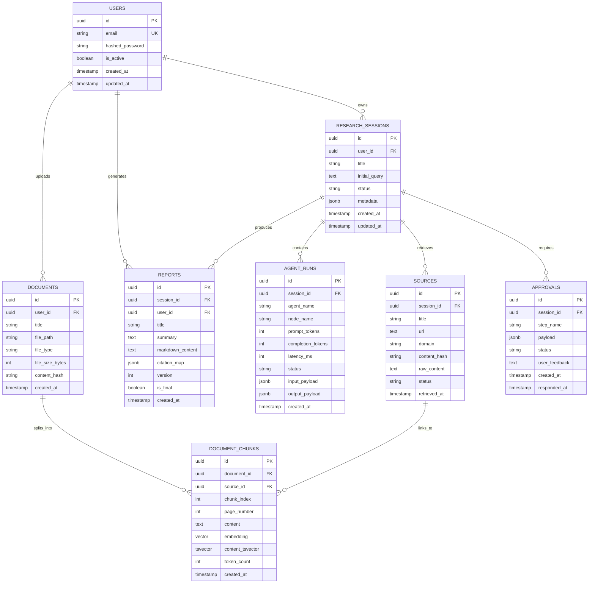

# ResearchPilot AI: Database Design & Entity Relationships

## 1. Overview & Architectural Principles
The data tier of ResearchPilot AI uses **PostgreSQL 16** with the **pgvector** extension. 
By combining relational data, state checkpointer tables, and high-dimensional vector embeddings within a single database instance, we achieve:
1. **ACID Transactional Consistency**: Seamless multi-table transactions uniting sessions, documents, chunks, and agent traces without split-brain sync bugs.
2. **Strict Multi-Tenancy**: Every entity enforces tenant scoping via `user_id` foreign keys and indexed authorization filters.
3. **Hybrid Search Synergy**: Vector embeddings (`vector(768)`) and full-text search indexes (`tsvector` + GIN) reside on the exact same table rows.

---

## 2. Entity-Relationship (ER) Diagram



---

## 3. Detailed Table Schema Definitions

### 3.1 `users`
Represents application accounts for multi-tenant isolation.
- `id` (UUID, Primary Key, `gen_random_uuid()`)
- `email` (VARCHAR(255), Unique, Indexed, Not Null)
- `hashed_password` (VARCHAR(255), Not Null)
- `is_active` (BOOLEAN, Default True)
- `created_at` (TIMESTAMPTZ, Default NOW())
- `updated_at` (TIMESTAMPTZ, Default NOW())

### 3.2 `research_sessions`
Represents an end-to-end research workflow execution.
- `id` (UUID, Primary Key, `gen_random_uuid()`)
- `user_id` (UUID, Foreign Key `users.id` ON DELETE CASCADE, Indexed)
- `title` (VARCHAR(255), Not Null)
- `initial_query` (TEXT, Not Null)
- `status` (VARCHAR(50), Indexed, Not Null) — `PENDING`, `RUNNING`, `NEEDS_APPROVAL`, `NEEDS_HUMAN_REVIEW`, `COMPLETED`, `FAILED`
- `metadata` (JSONB, Default `{}`)
- `created_at` (TIMESTAMPTZ, Default NOW())
- `updated_at` (TIMESTAMPTZ, Default NOW())

### 3.3 `agent_runs`
Captures per-node telemetry, token counts, and execution metrics.
- `id` (UUID, Primary Key, `gen_random_uuid()`)
- `session_id` (UUID, Foreign Key `research_sessions.id` ON DELETE CASCADE, Indexed)
- `agent_name` (VARCHAR(50), Not Null) — `orchestrator`, `research`, `analysis`, `writer`, `reviewer`
- `node_name` (VARCHAR(50), Not Null)
- `prompt_tokens` (INT, Default 0)
- `completion_tokens` (INT, Default 0)
- `latency_ms` (INT, Default 0)
- `status` (VARCHAR(50), Not Null)
- `input_payload` (JSONB, Nullable)
- `output_payload` (JSONB, Nullable)
- `created_at` (TIMESTAMPTZ, Default NOW())

### 3.4 `sources`
Stores discovered web sources and references.
- `id` (UUID, Primary Key, `gen_random_uuid()`)
- `session_id` (UUID, Foreign Key `research_sessions.id` ON DELETE CASCADE, Indexed)
- `title` (VARCHAR(500), Not Null)
- `url` (TEXT, Not Null)
- `domain` (VARCHAR(255), Indexed, Not Null)
- `content_hash` (CHAR(64), Indexed, Not Null) — SHA256 of extracted content
- `raw_content` (TEXT, Not Null)
- `status` (VARCHAR(50), Default 'SUCCESS')
- `retrieved_at` (TIMESTAMPTZ, Default NOW())

### 3.5 `documents` & `document_chunks`
Stores uploaded PDF documents and their semantic chunks.
- **`documents`**:
  - `id` (UUID, Primary Key)
  - `user_id` (UUID, Foreign Key `users.id` ON DELETE CASCADE, Indexed)
  - `title` (VARCHAR(255), Not Null)
  - `file_path` (VARCHAR(500), Not Null)
  - `file_type` (VARCHAR(50), Not Null) — `application/pdf`, `text/plain`
  - `file_size_bytes` (INT, Not Null)
  - `content_hash` (CHAR(64), Indexed, Not Null)
  - `created_at` (TIMESTAMPTZ, Default NOW())
- **`document_chunks`**:
  - `id` (UUID, Primary Key)
  - `document_id` (UUID, Foreign Key `documents.id` ON DELETE CASCADE, Nullable, Indexed)
  - `source_id` (UUID, Foreign Key `sources.id` ON DELETE CASCADE, Nullable, Indexed)
  - `chunk_index` (INT, Not Null)
  - `page_number` (INT, Default 1)
  - `content` (TEXT, Not Null)
  - `embedding` (`vector(768)`, Not Null)
  - `content_tsvector` (`tsvector`, Generated Stored)
  - `token_count` (INT, Not Null)
  - `created_at` (TIMESTAMPTZ, Default NOW())

### 3.6 `reports`
Stores synthesized and reviewed research reports.
- `id` (UUID, Primary Key)
- `session_id` (UUID, Foreign Key `research_sessions.id` ON DELETE CASCADE, Indexed)
- `user_id` (UUID, Foreign Key `users.id` ON DELETE CASCADE, Indexed)
- `title` (VARCHAR(500), Not Null)
- `summary` (TEXT, Not Null)
- `markdown_content` (TEXT, Not Null)
- `citation_map` (JSONB, Not Null) — `{ "[1]": { "source_id": "...", "quote": "...", "page": 1 } }`
- `version` (INT, Default 1)
- `is_final` (BOOLEAN, Default False)
- `created_at` (TIMESTAMPTZ, Default NOW())

### 3.7 `approvals`
Tracks human-in-the-loop review interrupts.
- `id` (UUID, Primary Key)
- `session_id` (UUID, Foreign Key `research_sessions.id` ON DELETE CASCADE, Indexed)
- `step_name` (VARCHAR(100), Not Null)
- `payload` (JSONB, Not Null)
- `status` (VARCHAR(50), Default 'PENDING') — `PENDING`, `APPROVED`, `REJECTED`
- `user_feedback` (TEXT, Nullable)
- `created_at` (TIMESTAMPTZ, Default NOW())
- `responded_at` (TIMESTAMPTZ, Nullable)

---

## 4. Indexing & Query Optimization Strategy

1. **Vector Index (HNSW)**:
   ```sql
   CREATE INDEX idx_document_chunks_embedding_hnsw 
   ON document_chunks 
   USING hnsw (embedding vector_cosine_ops)
   WITH (m = 16, ef_construction = 64);
   ```
2. **Full-Text Search Index (GIN)**:
   ```sql
   CREATE INDEX idx_document_chunks_tsvector_gin 
   ON document_chunks 
   USING gin (content_tsvector);
   ```
3. **Compound Tenant Indexes**:
   ```sql
   CREATE INDEX idx_sessions_user_status ON research_sessions (user_id, status);
   CREATE INDEX idx_chunks_doc_chunk ON document_chunks (document_id, chunk_index);
   CREATE INDEX idx_sources_session_hash ON sources (session_id, content_hash);
   ```
