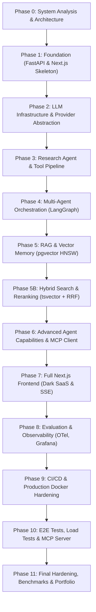

# ResearchPilot AI: Development Roadmap

This roadmap establishes the phased engineering sequence for building ResearchPilot AI. Each phase possesses strictly defined boundaries, acceptance criteria, and verification steps.

---

## Roadmap Phases

---

## Detailed Phase Breakdown

### Phase 0: System Analysis & Architecture (Current Phase)
- **Scope**: Read-only hardware audit, model selection for 8GB VRAM, system architecture design, database schema, technology stack documentation, Architecture Decision Records (ADRs).
- **Deliverables**: `docs/ARCHITECTURE.md`, `docs/TECH_STACK.md`, `docs/DATABASE_DESIGN.md`, `docs/DEVELOPMENT_ROADMAP.md`, `docs/ADR/`.
- **Exit Gate**: Hardware capabilities validated, ADRs approved, zero application code.

### Phase 1: Foundation
- **Scope**: FastAPI app factory, async SQLAlchemy 2, Alembic migrations (including pgvector extension), `/health` and `/ready` probes, JWT auth, Next.js shell layout, Docker Compose for Postgres and Redis.
- **Deliverables**: Working backend skeleton, working frontend shell, functional database migrations.

### Phase 2: LLM Infrastructure
- **Scope**: `LLMProvider` interface, `OllamaProvider`, global `asyncio.Semaphore(1)` concurrency control, structured JSON validation with schema repair, Qwen3 thinking tag stripping, streaming support, model health probes.
- **Deliverables**: `app/integrations/llm/`, unit and integration tests.

### Phase 3: Research Agent
- **Scope**: Search provider abstraction (Tavily/Brave/SearXNG), SSRF validation, readability web extraction, PyMuPDF parsing with page offsets, deduplication via SHA256, prompt-injection isolation wrappers.
- **Deliverables**: `app/agents/research.py`, `app/integrations/search/`, extraction tools.

### Phase 4: Multi-Agent Orchestration
- **Scope**: LangGraph StateGraph engine, Orchestrator, Analysis, Writer, and Reviewer agents. Bounded revision loop (max 3), `AsyncPostgresSaver` checkpointing, sequential LLM execution.
- **Deliverables**: `app/workflows/`, agent nodes, integration tests with real Ollama run.

### Phase 5: RAG & Memory
- **Scope**: Ingestion pipeline, semantic chunking, `nomic-embed-text` embeddings, pgvector HNSW index queries, citation verification against stored chunks, evaluation dataset.
- **Deliverables**: `app/services/ingestion_service.py`, `app/services/retrieval_service.py`.

### Phase 5B: Hybrid Search & Reranking
- **Scope**: PostgreSQL `tsvector` + GIN indexing, Reciprocal Rank Fusion (RRF), VRAM-safe configurable reranker, empirical before/after retrieval evaluation.
- **Deliverables**: `docs/HYBRID_SEARCH.md`, comparative benchmark report.

### Phase 6: Advanced Agent Capabilities & MCP Client
- **Scope**: MCP client for tool discovery, LangGraph human-in-the-loop interrupts (`interrupt()`), resilience against network failures, recovery from crashes.
- **Deliverables**: `app/integrations/mcp/`, approval UI integration, `docs/ADVANCED_CAPABILITIES.md`.

### Phase 7: Frontend Application
- **Scope**: Next.js App Router dark SaaS interface (Linear/Perplexity style), live SSE streaming, agent timeline trace, citation preview popovers, PDF/Markdown export.
- **Deliverables**: Full frontend application, `/ui-audit` verification.

### Phase 8: Evaluation & Observability
- **Scope**: OpenTelemetry tracing, Prometheus `/api/v1/metrics`, Grafana dashboards as code, adversarial test suite, empirical performance report.
- **Deliverables**: `docker-compose.observability.yml`, `docs/EVALUATION.md`, `docs/OBSERVABILITY.md`.

### Phase 9: CI/CD & Production Docker Hardening
- **Scope**: GitHub Actions (`ci.yml`, `docker-build.yml`, `security.yml`), multi-stage non-root Dockerfiles, Trivy vulnerability scans, Redis rate limiting.
- **Deliverables**: Hardened production configuration, `docs/CI_CD.md`.

### Phase 10: E2E Tests, Load Tests & MCP Server
- **Scope**: Playwright browser E2E tests, Locust load testing under single-LLM semaphore, ResearchPilot MCP server implementation (`start_research`, `get_report`, `search_my_documents`).
- **Deliverables**: `docs/LOAD_TESTING.md`, `docs/MCP_SERVER.md`.

### Phase 11: Final Hardening, Benchmarks & Portfolio Delivery
- **Scope**: Comprehensive regression testing, empirical benchmarking across models and retrieval modes, README demo GIFs, 2-minute demo video script, technical interview Q&A.
- **Deliverables**: `docs/PORTFOLIO.md`, `docs/BENCHMARKS.md`, `/release-check` completion.
