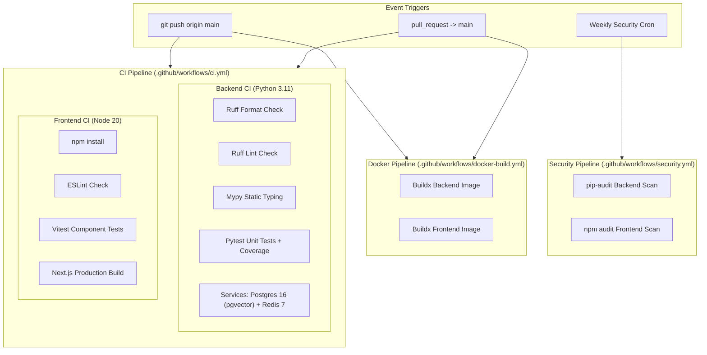

# DevOps, CI/CD & Production Container Hardening

This document provides complete technical specifications for continuous integration, container packaging, automated security auditing, and deployment orchestration in **ResearchPilot AI**.

---

## 1. CI/CD Architecture & Pipeline Overview

ResearchPilot AI uses GitHub Actions workflows for automated quality assurance on every commit and pull request against `main`.



---

## 2. GitHub Actions Workflows

### 2.1 Continuous Integration (`.github/workflows/ci.yml`)
- **Backend Job**:
  - Sets up Python 3.11 with pip caching pinned to `backend/pyproject.toml`.
  - Spins up containerized services: `pgvector/pgvector:pg16` and `redis:7-alpine`.
  - Executes code format checks (`ruff format --check`).
  - Executes strict linting (`ruff check`).
  - Executes static type verification (`mypy app`).
  - Executes the unit test suite (`pytest tests/unit/`) with line coverage reporting.
- **Frontend Job**:
  - Sets up Node.js 20 with npm caching.
  - Installs npm dependencies cleanly.
  - Runs Next.js ESLint validation (`npm run lint`).
  - Runs the Vitest test suite (`npm run test`).
  - Compiles the production standalone bundle (`npm run build`).

### 2.2 Container Build Verification (`.github/workflows/docker-build.yml`)
- Utilizes Docker Buildx with GitHub Actions layer cache (`type=gha,mode=max`) to verify that both `backend` and `frontend` Docker images compile without errors.

### 2.3 Security Auditing (`.github/workflows/security.yml`)
- Runs weekly on Mondays and on every pull request.
- Audits Python packages against the PyPI Advisory Database via `pip-audit`.
- Audits Node packages against high/critical CVEs via `npm audit --audit-level=high`.

### 2.4 Automated Dependency Updates (`.github/dependabot.yml`)
- Configured with weekly automated scanning for:
  - GitHub Actions dependencies (`/`)
  - Python dependencies (`/backend`)
  - Node dependencies (`/frontend`)

---

## 3. Production Container Hardening

Both application images adhere to the principle of least privilege, multi-stage separation, and minimal attack surface.

### 3.1 Backend Multi-Stage Dockerfile (`backend/Dockerfile`)

```dockerfile
# Stage 1: Build & Wheel Compilation
FROM python:3.11-slim AS builder
WORKDIR /build
RUN apt-get update && apt-get install -y --no-install-recommends \
    gcc libpq-dev && rm -rf /var/lib/apt/lists/*
COPY pyproject.toml .
RUN pip install --no-cache-dir --user .

# Stage 2: Hardened Runtime
FROM python:3.11-slim AS runtime
RUN groupadd -g 1001 appgroup && \
    useradd -u 1001 -g appgroup -s /bin/bash -m appuser
WORKDIR /app
COPY --from=builder /root/.local /home/appuser/.local
COPY --chown=appuser:appgroup app /app/app
COPY --chown=appuser:appgroup alembic /app/alembic
COPY --chown=appuser:appgroup alembic.ini /app/alembic.ini
USER appuser
ENV PATH=/home/appuser/.local/bin:$PATH
ENV PYTHONUNBUFFERED=1
EXPOSE 8000
HEALTHCHECK --interval=10s --timeout=5s --retries=3 \
    CMD python -c "import urllib.request; urllib.request.urlopen('http://127.0.0.1:8000/api/v1/health')" || exit 1
CMD ["uvicorn", "app.main:app", "--host", "0.0.0.0", "--port", "8000"]
```

**Security Controls Applied**:
1. **Unprivileged Non-Root User**: Runs as `appuser` (UID: 1001, GID: 1001); compilation tools (`gcc`) discarded in builder stage.
2. **Deterministic Health Check**: Native Python healthcheck testing `http://127.0.0.1:8000/api/v1/health` without requiring external binaries like curl or wget.
3. **Strict `.dockerignore`**: Excludes `.env`, `.git`, tests, caches, and local virtual environments.

### 3.2 Frontend Multi-Stage Dockerfile (`frontend/Dockerfile`)

```dockerfile
# Stage 1: Base & C-compat
FROM node:20-alpine AS base

# Stage 2: Dependency Resolution
FROM base AS deps
RUN apk add --no-cache libc6-compat
WORKDIR /app
COPY package.json package-lock.json* ./
RUN if [ -f package-lock.json ]; then npm ci; else npm install; fi

# Stage 3: Standalone Compilation
FROM base AS builder
WORKDIR /app
COPY --from=deps /app/node_modules ./node_modules
COPY . .
ENV NEXT_TELEMETRY_DISABLED=1
RUN npm run build

# Stage 4: Minimal Runner
FROM base AS runner
WORKDIR /app
ENV NODE_ENV=production
ENV NEXT_TELEMETRY_DISABLED=1
RUN addgroup --system --gid 1001 nodejs
RUN adduser --system --uid 1001 nextjs
COPY --from=builder /app/public ./public
COPY --from=builder --chown=nextjs:nodejs /app/.next/standalone ./
COPY --from=builder --chown=nextjs:nodejs /app/.next/static ./.next/static
USER nextjs
EXPOSE 3000
ENV PORT=3000
ENV HOSTNAME="0.0.0.0"
HEALTHCHECK --interval=15s --timeout=5s --retries=3 \
  CMD wget --no-verbose --tries=1 --spider http://127.0.0.1:3000 || exit 1
CMD ["node", "server.js"]
```

**Security & Optimization Controls Applied**:
1. **Next.js Standalone Mode**: Only copies traced server dependencies into `.next/standalone`, dropping unused development tooling from image.
2. **Non-Root Execution**: Runs under unprivileged `nextjs` user (UID: 1001).
3. **Alpine Base**: Minimal image footprint (~120MB final runtime image).

---

## 4. Production Orchestration (`docker-compose.yml`)

The root `docker-compose.yml` configures five production service containers:

| Service | Image / Build | Port | Health Check | Description |
|---|---|---|---|---|
| `postgres` | `pgvector/pgvector:pg16` | 5432 | `pg_isready` | PostgreSQL 16 with pgvector extension |
| `redis` | `redis:7-alpine` | 6379 | `redis-cli ping` | Redis cache and session coordinator |
| `searxng` | `searxng/searxng:latest` | 8080 | HTTP `/healthz` | Privacy-preserving metasearch aggregator |
| `backend` | `./backend/Dockerfile` | 8000 | HTTP `/api/v1/health` | FastAPI + LangGraph orchestration engine |
| `frontend` | `./frontend/Dockerfile` | 3000 | HTTP `3000/` | Next.js 14 App Router web interface |

### 4.1 Host Ollama Network Bridge
To communicate with the host's Ollama daemon on Windows / WSL2, the backend service declares:
```yaml
extra_hosts:
  - "host.docker.internal:host-gateway"
environment:
  - OLLAMA_BASE_URL=http://host.docker.internal:11434
```

---

## 5. Local Developer Automation (`Makefile`)

Common developer workflows are codified in the root `Makefile`:

```bash
make dev           # Start postgres, redis, and searxng background containers
make migrate       # Run database schema migrations with Alembic
make lint          # Run Ruff lint, Ruff format check, Mypy, and ESLint
make test          # Run full unit test suite (pytest + vitest)
make build         # Build production Docker images
make ci            # Run complete local CI pipeline (lint + test + build)
make eval          # Run automated evaluation benchmark against local Ollama
make observability # Spin up Prometheus & Grafana monitoring stack
make down          # Stop all containers cleanly
make clean         # Purge volumes, dangling images, and Python caches
```
