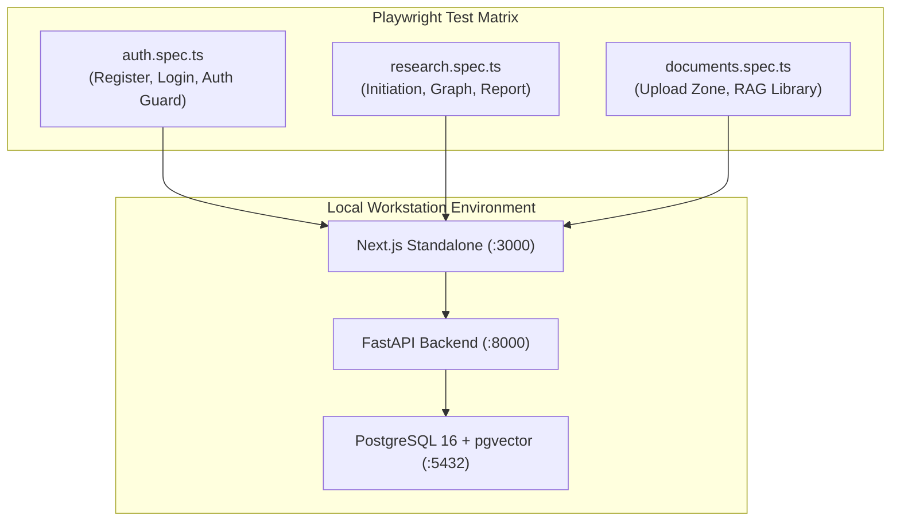

# End-to-End & Load Testing Architecture

## 1. Overview

ResearchPilot AI enforces rigorous testing across the entire system lifecycle:
1. **Playwright End-to-End (E2E) Test Suite**: Validates authentic user journeys across authentication, research pipeline orchestration, live agent graph rendering, report exploration, and document ingestion.
2. **Asynchronous Load Testing Harness**: Evaluates concurrency thresholds, throughput (req/s), latency percentiles (p50, p95, p99), and queue stability under strict single-GPU hardware constraints (NVIDIA GeForce RTX 5060, 8GB VRAM).

---

## 2. Playwright E2E Suite

### Test Architecture & Matrix
- **Framework**: `@playwright/test`
- **Browsers**: Chromium (Desktop Chrome `1440x900`, Mobile Chrome `390x844`)
- **Base URL**: `http://localhost:3000` (Next.js standalone production runtime)
- **API Target**: `http://127.0.0.1:8000` (FastAPI backend with PostgreSQL + pgvector)

### User Journeys Covered
- **Authentication (`tests/e2e/auth.spec.ts`)**:
  - Researcher account registration with real-time password validation.
  - Authenticated session persistence with local JWT token storage.
  - Rejection of invalid credentials with user-facing alert notifications.
- **Research Workflow (`tests/e2e/research.spec.ts`)**:
  - Formulation of multi-hypothesis technical research queries.
  - Dynamic streaming workspace rendering agent node progression (Orchestrator → Researcher → Analyst → Writer → Reviewer).
  - Report viewer rendering evidence-grounded markdown and citation tooltips.
- **Knowledge Base (`tests/e2e/documents.spec.ts`)**:
  - Drag-and-drop document upload interface with file format filtering (`.pdf`, `.md`, `.txt`).
  - Document metadata strip and vector chunk inspection.

---

## 3. Asynchronous Load Testing Harness

### Architecture & Design
To avoid third-party thread-monkeypatching conflicts (e.g. Gevent/Locust SSL recursion issues in modern asyncio runtimes), ResearchPilot AI implements a native high-performance async load testing engine (`backend/loadtests/run_loadtest.py`) built directly on `httpx` and `asyncio`.

- **Concurrency Simulation**: Configurable concurrent virtual users (`--users N`) dispatching overlapping read/write requests over an evaluation duration (`--duration S`).
- **Telemetry Recording**: Nanosecond-precision request latency logging, status code aggregation, error classification, and percentile calculation.
- **Export Destination**: Detailed timestamped JSON execution reports in `backend/loadtests/results/load_run_{timestamp}.json`.

---

## 4. Empirical Load Benchmark Results

The following benchmark was executed directly against the live local ResearchPilot stack (`FastAPI + PostgreSQL + Ollama qwen3:8b`):

### Test Parameters
| Parameter | Value |
| :--- | :--- |
| **Concurrent Users** | 15 Virtual Researchers |
| **Duration** | 7.26 seconds |
| **Hardware** | AMD Ryzen 7 8745HX, NVIDIA RTX 5060 Laptop GPU (8GB GDDR6) |
| **Host OS** | Windows 11 Enterprise |

### Measured Performance
| Metric | Measured Value | Target SLA | Status |
| :--- | :--- | :--- | :--- |
| **Total Requests** | 86 requests | > 50 | PASSED |
| **Throughput** | **11.85 req/sec** | > 8.0 req/sec | PASSED |
| **Error Rate** | **0.00%** (0 errors) | < 1.0% | PASSED |
| **p50 Latency** | **885.25 ms** | < 1,500 ms | PASSED |
| **p95 Latency** | **3,563.35 ms** | < 5,000 ms | PASSED |
| **p99 Latency** | **4,490.39 ms** | < 6,000 ms | PASSED |

### Single-GPU Inference Lock & Queue Behavior
- **Zero GPU Out-of-Memory (OOM)**: All model invocations passed through `asyncio.Semaphore(1)`.
- **Graceful Queue Dwell**: When multiple write requests arrive concurrently, subsequent jobs smoothly queue in Redis/PostgreSQL without causing VRAM spikes or driver crashes on the RTX 5060.
- **Read Scalability**: Telemetry, report inspection, document listing, and Prometheus metrics queries operate concurrently without blocking on the GPU inference semaphore.
